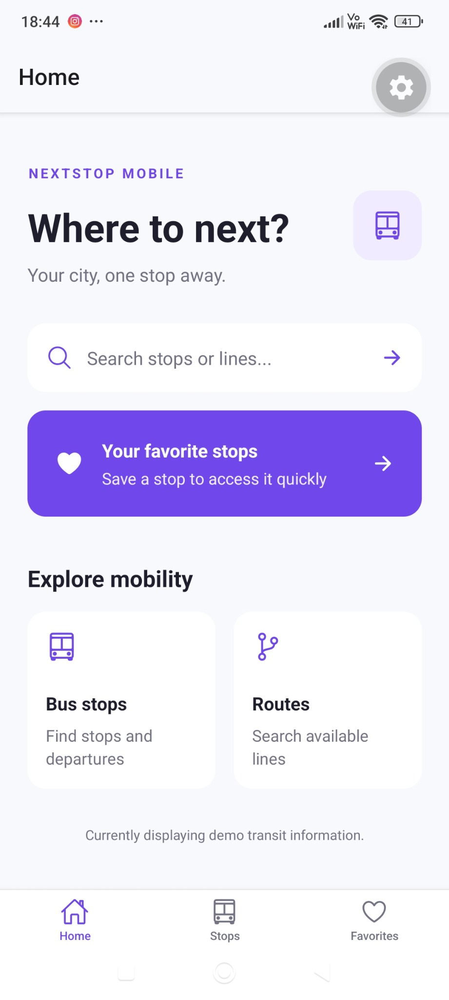
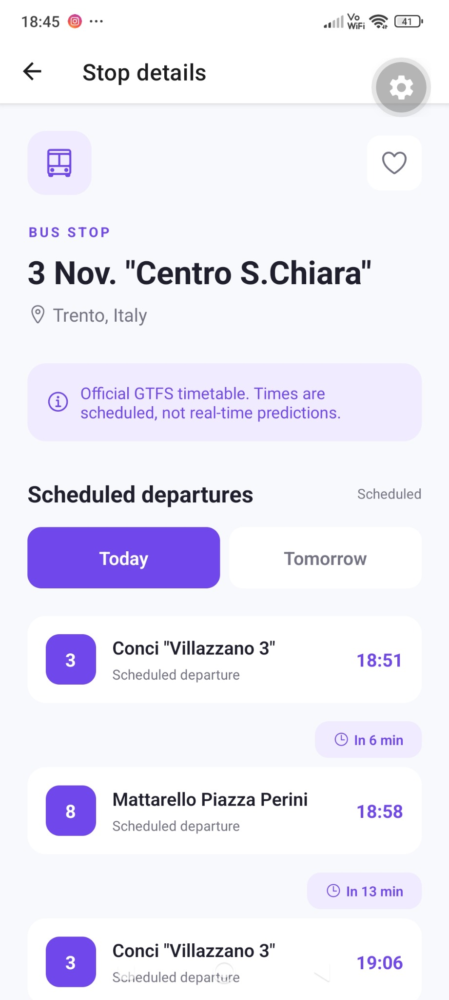
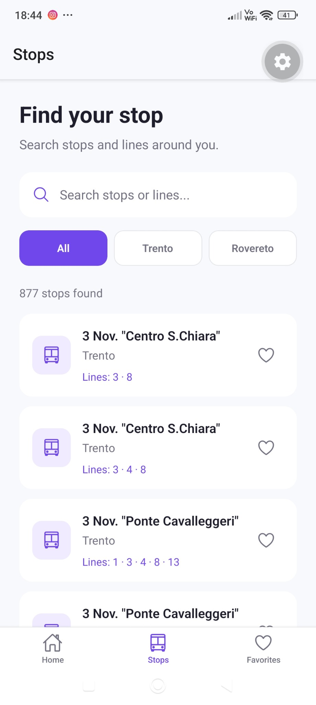
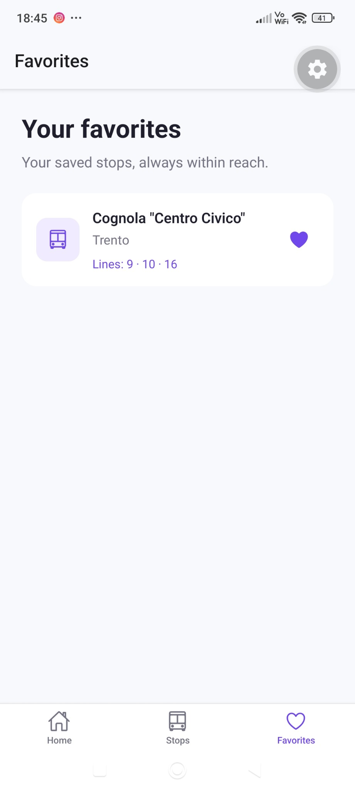

# NextStop Mobile 🚌

**Fermate, linee e partenze programmate del trasporto pubblico di Trento e Rovereto, in un'app mobile.**

NextStop Mobile è un progetto personale sviluppato con **React Native, Expo e TypeScript**. L'app permette di cercare le fermate, consultare gli orari programmati dei mezzi e salvare le fermate preferite, utilizzando dati GTFS di **Trentino Trasporti**.

Il progetto nasce per approfondire lo sviluppo mobile e mettere in pratica la gestione di dati di trasporto reali, con attenzione all'esperienza utente e alla separazione tra interfaccia, servizi e dati.

> **Nota:** gli orari visualizzati sono **programmati**, non in tempo reale. Non vengono mostrati ritardi, cancellazioni o posizioni effettive dei mezzi.

## Funzionalità

- **Ricerca delle fermate:** ricerca per nome, città e numero di linea.
- **Filtri per area:** selezione delle fermate associate a Trento e Rovereto.
- **Dettaglio fermata:** linee disponibili, destinazioni e orari programmati.
- **Oggi / Domani:** consultazione delle prossime partenze di oggi e degli orari del giorno successivo.
- **Conto alla rovescia:** minuti mancanti alla partenza *programmata*.
- **Preferiti:** salvataggio locale delle fermate tramite AsyncStorage.
- **Navigazione a schede:** Home, Stops e Favorites, con schermata di dettaglio dedicata.
- **Stati vuoti:** messaggi dedicati per ricerche senza risultati e partenze non disponibili.


## Screenshot

<p align="center">
  
  
  
  
</p>


## Tecnologie utilizzate

| Tecnologia | Utilizzo |
| --- | --- |
| React Native | Sviluppo dell'interfaccia mobile |
| Expo | Ambiente di sviluppo e strumenti per l'app |
| Expo Router | Navigazione basata sulla struttura dei file |
| TypeScript | Tipizzazione di componenti, dati e servizi |
| AsyncStorage | Persistenza locale dei preferiti |
| Node.js | Script di importazione e trasformazione GTFS |
| csv-parse | Lettura dei file CSV del feed GTFS |
| Vitest | Test automatici della logica degli orari |

## Dati di trasporto e integrazione GTFS

NextStop Mobile utilizza un **feed GTFS statico** fornito da Trentino Trasporti. Gli script Node.js elaborano i file CSV originali e generano i JSON utilizzati direttamente dall'app.

Il dataset importato comprende:

| Dato | Quantità |
| --- | ---: |
| Fermate selezionate | **877** |
| Passaggi programmati associati alle fermate | **81.930** |
| Calendari di servizio | **38** |
| Passaggi GTFS con orario oltre le 24:00 | **89** |

Le fermate sono suddivise nell'app in **595 associate a Trento** e **282 associate a Rovereto**, secondo una classificazione iniziale basata sulle zone GTFS; queste etichette non costituiscono una verifica dei confini comunali.

La gestione degli orari tiene conto di:

- giorni di servizio definiti in `calendar.txt`;
- eccezioni e festività riportate in `calendar_dates.txt`;
- associazioni tra linee, corse e fermate (`routes.txt`, `trips.txt`, `stop_times.txt`);
- orari GTFS oltre le `24:00`, riferiti al giorno di servizio precedente.

**Validità del feed importato:** dal **10 settembre 2026** all'**8 giugno 2027**. Gli orari potrebbero diventare obsoleti o non riflettere modifiche successive del servizio.

### Flusso dei dati

```text
File GTFS originali (CSV)
        │
        ▼
Script Node.js in scripts/
        │
        ▼
JSON elaborati in src/data/
        │
        ▼
Servizi TypeScript in src/services/
        │
        ▼
Schermate React Native
```

I file GTFS originali non vengono inclusi nel repository; i JSON elaborati sono invece necessari all'esecuzione dell'app e vengono distribuiti con il progetto.

## Struttura del progetto

```text
nextstop-mobile/
├── src/
│   ├── app/
│   │   ├── (tabs)/           # Home, fermate e preferiti
│   │   └── stop/[id].tsx     # Dettaglio fermata
│   ├── components/           # Componenti riutilizzabili
│   ├── constants/            # Tema e stili condivisi
│   ├── context/              # Gestione dei preferiti
│   ├── data/                 # Dataset JSON elaborati
│   ├── services/             # Ricerca fermate e orari GTFS
│   │   └── __tests__/        # Test automatici
│   └── types/                # Tipi TypeScript
├── scripts/
│   ├── import-gtfs.mjs
│   └── import-gtfs-departures.mjs
├── package.json
└── README.md
```

## Installazione e avvio

### Requisiti

- Node.js
- pnpm
- Expo Go su un dispositivo compatibile oppure un ambiente di sviluppo React Native

Clona il repository e installa le dipendenze:

```bash
git clone https://github.com/alessiaasmeraglia/nextstop-mobile.git
cd nextstop-mobile
pnpm install
```

Avvia il server di sviluppo:

```bash
pnpm exec expo start
```

Apri l'app con Expo Go seguendo le indicazioni del terminale.

**Nota:** per il normale avvio non è necessario scaricare nuovamente i file GTFS sorgenti: l'app utilizza i JSON già generati in `src/data/`.

## Test e controlli

Controllo TypeScript:

```bash
pnpm exec tsc --noEmit
```

Test automatici:

```bash
pnpm test
```

Diagnostica Expo:

```bash
pnpm dlx expo-doctor
```

Al momento della preparazione del progetto risultano superati **6 test Vitest** e **21 controlli su 21 di Expo Doctor**, senza errori TypeScript. I test automatici verificano alcuni casi significativi: giorni feriali, festività, ordine cronologico, passaggi dopo mezzanotte, validità del feed e date non valide.

Questi controlli non sostituiscono una verifica funzionale completa su dispositivi reali.

## Fonte dei dati e attribuzione

Dati di trasporto pubblico forniti da **Trentino Trasporti S.p.A.**

- **Fonte:** [Trentino Trasporti — Open Data](https://www.trentinotrasporti.it/it/opendata-it)
- **Licenza dei dati:** [Creative Commons Attribuzione 2.5 Italia (CC BY 2.5 IT)](https://creativecommons.org/licenses/by/2.5/it/)
- **Versione del feed importato:** `20260930190904.696`
- **Periodo di validità dichiarato:** 10/09/2026 – 08/06/2027
- **Modifiche effettuate:** selezione e classificazione delle fermate, associazione delle linee, elaborazione delle corse, conversione in JSON e interrogazione dei calendari GTFS.

NextStop Mobile è un **progetto indipendente a scopo dimostrativo** e non è affiliato, approvato o sponsorizzato da Trentino Trasporti S.p.A.

La licenza indicata riguarda i dati di trasporto e non implica automaticamente la stessa licenza per il codice sorgente dell'app.

## Limitazioni e sviluppi futuri

La versione attuale ha alcune limitazioni note:

- non utilizza API in tempo reale;
- il dataset è statico e deve essere aggiornato quando viene pubblicato un nuovo feed;
- i dati degli orari sono inclusi nel bundle senza una specifica ottimizzazione delle dimensioni;
- rimangono utili ulteriori test su dispositivi, accessibilità, cambi d'ora e casi limite dei calendari.

Possibili evoluzioni:

- mappa interattiva delle fermate;
- archiviazione locale più efficiente dei dati GTFS;
- aggiornamento periodico del feed;
- test aggiuntivi e miglioramenti dell'accessibilità.

## Autrice

**Alessia Smeraglia**

- [GitHub](https://github.com/alessiaasmeraglia)
- [Portfolio](https://alessia-smeraglia-portfolio.vercel.app/)
